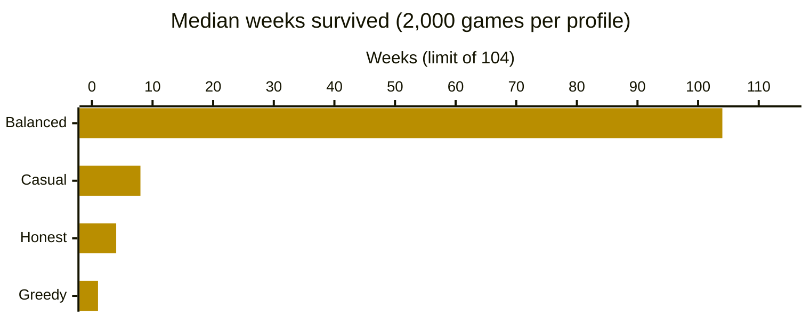
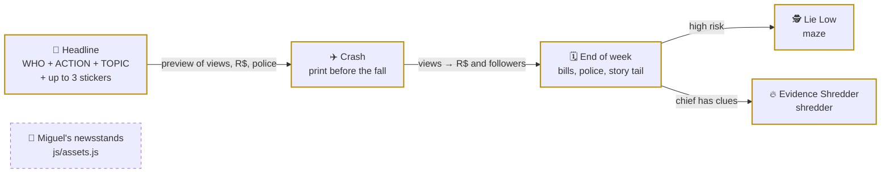

<div align="center">

# 📰 Editorial da Mentira

> 🌐 Leia em [Português](./README.md)

[](#-how-it-works)

[](#️-technologies-used)

[](https://daviperrelli15.github.io/editorial-da-mentira/)
[](./LICENSE)
[](#-project-in-numbers)
[](#-team-and-context)
[](https://github.com/DaviPerrelli15/editorial-da-mentira/commits/main)

`HTML · CSS · vanilla JavaScript · no build · 3 mini-games · MIT`

**[🌐 Open the live version](https://daviperrelli15.github.io/editorial-da-mentira/)**

</div>

A browser game (in Portuguese) where you are the editor of the **Gazeta da Manhã**: you build headlines, slap sensationalist stickers on them to make money, and try to pay the week's bills before **Chief Amaral** gathers enough evidence to arrest you. **Playable from start to finish:** weeks and months, bills with their own due dates, the news crash, the "Lie Low" maze, the Evidence Shredder, upgrades and 6 different endings; the newsstand images are being made and plug in by changing one line.

> [!TIP]
> **Want to tweak the balance?** Every number in the game lives in [`js/config.js`](./js/config.js), each one with its reason in a comment. After changing it, run `node tools/simulacao.js` to check that the game is still balanced (see [Tests](#-tests)).

---

## 📑 Table of Contents

- [🗂️ Project Structure](#️-project-structure)
- [🗂️ Project Structure - tree](#️-project-structure---tree)
- [👥 Team and context](#-team-and-context)
- [📊 Project in numbers](#-project-in-numbers)
- [🔄 How it works](#-how-it-works)
- [🗄️ Data model](#️-data-model)
- [📰 Business rules](#-business-rules)
- [🧪 Tests](#-tests)
- [⚙️ Technologies used](#️-technologies-used)
- [🚀 How to run](#-how-to-run)
- [🤝 Contributing](#-contributing)
- [📄 License](#-license)

---

## 🗂️ Project Structure

| Path | Description |
|---|---|
| `index.html` | The game's only page: start screen, status bar, the 3 columns (house and bills · newsroom · stickers and backstage), mobile tabs and the mini-game windows. Loads the scripts in order, without modules, so it opens with a double click |
| `css/base.css` | Color and font tokens, reset, buttons, icons and visible focus |
| `css/layout.css` | Fixed screen, status bar, 3-column grid with independent scrolling and the mobile tabs (below 900 px) |
| `css/components.css` | Property polaroid, Chief Amaral, bill sticky notes, newspaper, headline builder, forecast, feed, stickers and upgrades |
| `css/overlays.css` | Dialogs, mini-game cards, ending screens and the arrest sequence |
| `js/config.js` | Every balance number in a single object (`EDM.CONFIG`), with a comment explaining each value |
| `js/assets.js` | Image paths in one place: `casas` theme (current) and `bancas` theme (ready for the new newsstand images) |
| `js/core/rules.js` | Pure rules, no DOM: views, money, police, clues, bills, crash, upgrades, end of week and events. The simulation runs this same code |
| `js/core/util.js` | Seeded random numbers, pt-BR formatting (R$, "1,2 mil") and numeric helpers |
| `js/core/storage.js` | Save/continue, high score and sound preference in `localStorage`, safe in private mode |
| `js/core/audio.js` | Sound effects synthesized with Web Audio (the project has no audio files) |
| `js/data/news.js` | Headline parts (WHO · ACTION · TOPIC) with an absurdity level, and the function that assembles the text with the stickers' prefixes and suffixes |
| `js/data/content.js` | Game text: stickers, bills, endings, events, narrator, comments, the chief's lines and upgrades |
| `js/ui/` | Interface split by responsibility: status bar, left column, newsroom, stickers, upgrades, tabs, endings, dialogs, SVG icons and SVG illustrations |
| `js/minigames/crash.js` | News crash: a newspaper paper plane on canvas, crash point drawn before takeoff |
| `js/minigames/maze.js` | "Lie Low" maze: guards with vision cones, BFS chase, keyboard, D-pad and drag on mobile |
| `js/minigames/shredder.js` | Evidence Shredder: shred the falling evidence before it reaches the chief's desk |
| `js/game.js` | Controller: holds the game state, calls the rules, opens the mini-games and redraws the screen |
| `js/main.js` | Startup: icons, events and start screen |
| `img/adesivos/` | The team's 7 custom stickers (WebP with transparent background) |
| `img/bancas/` | Today it only has `LEIA-ME.txt`: this is where the 10 newsstand images go |
| `img/casa1.jpg` … `img/casa10.jpg` | Photos of the 10 house levels, used until the `bancas` theme is turned on |
| `tools/simulacao.js` | Balance simulation in Node.js: plays thousands of games with 4 player profiles and checks 7 goals |
| `LICENSE` | MIT license text |
| `README.en.md` | This documentation in English |
| `README.md` | This documentation in Portuguese |

---

## 🗂️ Project Structure - tree

```
🗂️
├── 📁 css
│  ├── 🎨 base.css
│  ├── 🎨 components.css
│  ├── 🎨 layout.css
│  └── 🎨 overlays.css
├── 📁 img
│  ├── 📁 adesivos
│  │  └── … (7 .webp files)
│  ├── 📁 bancas
│  │  └── 📄 LEIA-ME.txt
│  └── … (10 files casa1.jpg to casa10.jpg)
├── 📁 js
│  ├── 📁 core
│  │  ├── ⚙️ audio.js
│  │  ├── ⚙️ rules.js
│  │  ├── ⚙️ storage.js
│  │  └── ⚙️ util.js
│  ├── 📁 data
│  │  ├── ⚙️ content.js
│  │  └── ⚙️ news.js
│  ├── 📁 minigames
│  │  ├── ⚙️ crash.js
│  │  ├── ⚙️ maze.js
│  │  └── ⚙️ shredder.js
│  ├── 📁 ui
│  │  └── … (11 .js files)
│  ├── ⚙️ assets.js
│  ├── 🔧 config.js
│  ├── ⚙️ game.js
│  └── ⚙️ main.js
├── 📁 tools
│  └── 🧪 simulacao.js
├── 🌐 index.html
├── 🗒️ LICENSE
├── 🇺🇸 README.en.md
└── 🇧🇷 README.md
```

---

## 👥 Team and context

A game made by a team of three. The team sets the creative direction, playtests and writes the change list for each version (split into **System** and **Style**), makes its own art (like the stickers and the newsstands) and publishes the game on GitHub Pages.

### 🌟 Who builds Editorial da Mentira

<table>
  <tr>
    <td align="center" width="20%"><a href="https://github.com/DaviPerrelli15"><br/><b>Davi Perrelli</b></a><br/><sub>🎮 concept, playtesting and publishing</sub></td>
    <td align="center" width="20%"><a href="https://github.com/carloshenrique1611"><br/><b>Carlos Henrique</b></a><br/><sub>🎮 concept, playtesting and curation</sub></td>
    <td align="center" width="20%"><a href="https://github.com/miguelarthur202"><br/><b>Miguel Arthur</b></a><br/><sub>🎨 newsstand art</sub></td>
  </tr>
</table>

---

## 📊 Project in numbers

| 📰 Possible headlines | 🏷️ Stickers | 🎮 Mini-games | 🧾 Bills | 🛠️ Upgrades |
|:---:|:---:|:---:|:---:|:---:|
| **2,808** (13 × 12 × 18) | **7** (3 secret combos) | **3** | **5** (5 endings + arrest) | **16** (+ 10 property levels) |

**How long each player style survives**



<sub>Output of `node tools/simulacao.js 2000 104` on Nov 6, 2026. The balanced player hits the 104-week limit (2 game years); even so, 29.8% of those games end earlier. The 4 profiles are explained in [Tests](#-tests).</sub>

<details>
<summary>📋 See the chart numbers as a table</summary>

| Profile | Median weeks | Reached week 26 | Reached week 104 | Most common ending |
|---|---:|---:|---:|---|
| Balanced | 104 | 78.9% | 70.2% | survived (70.1%) · rent (12.5%) |
| Casual | 8 | 0.5% | 0.0% | arrest (83.2%) |
| Honest | 4 | 0.0% | 0.0% | groceries (99.8%) |
| Greedy | 1 | 0.0% | 0.0% | arrest (100%) |

</details>

---

## 🔄 How it works



<sub>Yellow border = already in the code · dashed border = next step (images being made; the code is ready)</sub>

Every week you get 3 actions. Each publication goes through the **crash**: the views multiplier keeps rising and the crash point was drawn before takeoff, with `P(crash ≥ x) = 0.94 ÷ x`. Printed in time: the story earns `views × multiplier`. Crashed: it gets debunked, earns only 35% and, if it had stickers, draws more police. **Reputation** multiplies views by `0.5 + reputation/100` and decides how many readers become followers; views turn into money through the RPM in [`js/config.js`](./js/config.js).

**Chief Amaral** only gets a clue when you lose a mini-game (maze or Evidence Shredder), never by luck. Each clue makes police attention rise 20% faster and adds one more guard to the maze; with 2 clues, the chief himself walks into the maze.

The preview under the newspaper comes from the same function that applies the publication (`EDM.Rules.evaluateDraft`). Real output (Node.js 22) for the headline "O síndico anuncia que vai chover no domingo." ("The building manager announces it will rain on Sunday."), at the starting state:

```text
no sticker                                    → 577 views · R$ 14  · police +0%  · reputation +3
Sensacionalismo                               → 692 views · R$ 51  · police +5%  · reputation 0
Sensacionalismo + Especialista Anônimo        → 726 views · R$ 78  · police +6%  · reputation 0
Especialista Anônimo + Cura Milagrosa (combo) → 905 views · R$ 113 · police +12% · reputation −7
```

And the crash draw, checked over 100,000 flights (`EDM.Rules.drawCrashPoint` with seed 42):

```text
goes past x1.5 → 62.9%  (theory 62.7%)
goes past x2   → 47.3%  (theory 47.0%)
goes past x5   → 18.9%  (theory 18.8%)
goes past x10  →  9.3%  (theory  9.4%)
```

---

## 🗄️ Data model

The game has no server: the run lives in the browser's `localStorage`, under three keys.

| Key | What it stores |
|---|---|
| `edm_save_v3` | The whole game state as JSON (saved after every action) |
| `edm_record_weeks` | The high score in weeks survived |
| `edm_sound` | `on` or `off` |

**`edm_save_v3`**: object created by `EDM.Rules.createState()`.

| Field | Type in file | Example | Notes |
|---|---|---|---|
| `version` | number | `3` | A save from another version is ignored (it doesn't break the game) |
| `week` | number | `1` | Current week; 4 weeks = 1 month of bills |
| `actions` | number | `3` | Actions left this week |
| `money` | number | `300` | Cash (R$) |
| `followers` | number | `40` | Followers |
| `reputation` | number | `15` | 0 to 100 (Low up to 34, Medium up to 69, High above) |
| `police` | number | `0` | Police attention, 0 to 100; at 100 the Federal Police knocks on the door |
| `clues` | number | `0` | The chief's clues, 0 to 3 |
| `property` | number | `1` | House/newsstand level, 1 to 10 |
| `upgrades` | object | `{"camera": 2}` | Level bought for each upgrade |
| `bills` | list | `{"id": "internet", "owed": 130, "dueWeek": 1, "lateWeeks": 0}` | One entry per bill: amount owed, due week and weeks late |
| `posts` | list | `{"id": 1, "text": "...", "views": 657, "tailLeft": 3, ...}` | Stories still live (they earn for 3 more weeks) |
| `archive` | list | | Up to 20 old stories (the "Ghost from the past" event can bring one back) |
| `crashHistory` | list | `[1.31, 7.4]` | Last 10 crash points |
| `shredCooldown` | number | `0` | Weeks until the Evidence Shredder can be used again |
| `stats` | object | `{"weeks": 0, "publications": 0, ...}` | Numbers for the ending screen |
| `over` | text or `null` | `"aluguel"` | Which ending happened |

- **Coverage:** the whole run; reloading the page and clicking **Continuar** picks up exactly where you left off.
- **Quirk:** the headline being built (parts and stickers) is not saved; when you continue, the game draws a new one.

---

## 📰 Business rules

The team's change list (PDF "Editorial da Mentira"), **System** part:

- **RN01:** switch the day system to weeks.
- **RN02:** keep the screen fixed (no scrolling the whole page).
- **RN03:** one scrollbar for each of the 3 sections of the screen.
- **RN04:** balance "Ficar na Miúda" (Lie Low).
- **RN05:** a news "crash" system, based on the paper plane mini-game.
- **RN06:** balance the bill amounts (raise them).
- **RN07:** a base story (no stickers) can't make good money.
- **RN08:** a story without stickers doesn't raise the police bar.
- **RN09:** start the game with low reputation.
- **RN10:** reputation affects the number of views, and views become money.
- **RN11:** connect reputation with followers, with a clear formula.
- **RN12:** an upgrade system.
- **RN13:** electricity and water bills.
- **RN14:** rename "Comida" (Food) to "Compras" (Groceries).
- **RN15:** a different ending for each overdue bill.
- **RN16:** manual bill payment, with realistic due dates.
- **RN17:** a mini-game in "Ficar na Miúda", based on the maze game.
- **RN18:** if the player loses the "Ficar na Miúda" mini-game, the chief gets a clue.
- **RN19:** remove the random clues the chief used to get.
- **RN20:** change the background of the story's photo according to its topic.
- **RN21:** more stories, preferably funny ones.
- **RN22:** a mini-game to trigger strategically.
- **RN23:** the mini-games affect the detective/chief.

**Style** part: status bar matching the reference, custom stickers, one image per story, newsstands instead of houses, a nicer chief icon and nicer status bar icons.

All of them are implemented. The numeric rules (RN04 to RN11, RN15, RN16) live in [`js/core/rules.js`](./js/core/rules.js) with their values in [`js/config.js`](./js/config.js); RN05, RN17 and RN22 are the three files in [`js/minigames/`](./js/minigames/). For RN22 (ambiguous wording in the PDF), the implemented reading is the **Evidence Shredder**: you choose when to use it (1 action, 3-week cooldown) and, if you shred the evidence, the chief loses a clue. Switching to the newsstands (Style) only depends on the images: the paths are in [`js/assets.js`](./js/assets.js).

---

## 🧪 Tests

The simulation plays automatic games with **the same rules as the game** (it loads `config.js` and `rules.js`) and 4 player profiles:

| Profile | How it plays |
|---|---|
| Honest | Only publishes stories without stickers |
| Greedy | Always the 3 most profitable stickers, waits for the crash to reach x3 |
| Casual | Random choices; runs from the police now and then |
| Balanced | Manages weekly risk, lies low in the maze when police goes over 50%, uses the Evidence Shredder at 2 clues and invests in reputation |

```bash
node tools/simulacao.js            # 2,000 games per profile, up to 104 weeks
node tools/simulacao.js 5000 52    # games per profile, max weeks
```

Real output (Node.js 22, 2,000 games per profile), final part (the tool prints in Portuguese):

```text
▶ EQUILIBRADO (2000 partidas)
  semanas sobrevividas: p10 8 · mediana 104 · p90 104
  chegou à semana 8: 96.2% · 26: 78.9% · 52: 73.5% · 104: 70.2%
  imóvel final (mediana): nível 10 · p90 nível 10 · seguidores (mediana) 237.885

METAS
  [OK]    Notícia honesta não paga as contas (honesto quebra antes da semana 16)
  [OK]    Honesto nunca é preso (sem adesivo não há polícia)
  [OK]    Ganância é punida (ganancioso preso antes da semana 10)
  [OK]    Jogar no automático não basta (casual: mediana < 26 semanas)
  [OK]    Jogo é vencível com cuidado (equilibrado: mediana ≥ 40 semanas)
  [OK]    Jogo não é fácil demais (equilibrado: no máx. 75% chegam à semana 104)
  [OK]    Equilibrado progride (mediana do imóvel ≥ nível 5)
```

The command exits with code 1 if any goal fails, so it works as a check before publishing a balance change.

---

## ⚙️ Technologies used

- [HTML](https://developer.mozilla.org/en-US/docs/Web/HTML): structure of the single page, with accessible buttons and dialogs
- [CSS](https://developer.mozilla.org/en-US/docs/Web/CSS): grid layout with 3 independently scrolling columns, mobile tabs, dark theme with newspaper paper
- [JavaScript](https://developer.mozilla.org/en-US/docs/Web/JavaScript): rules, interface and mini-games, as classic scripts under the `EDM` namespace (no modules, so it opens with a double click)
- [Canvas API](https://developer.mozilla.org/en-US/docs/Web/API/Canvas_API): the three mini-games
- [SVG](https://developer.mozilla.org/en-US/docs/Web/SVG): interface icons, story illustrations, the chief's portrait and the ending art, all made for the project
- [Web Audio API](https://developer.mozilla.org/en-US/docs/Web/API/Web_Audio_API): sound effects generated in the browser
- [Web Storage (`localStorage`)](https://developer.mozilla.org/en-US/docs/Web/API/Window/localStorage): save and continue, high score and sound
- [Google Fonts](https://fonts.google.com/): [Barlow](https://fonts.google.com/specimen/Barlow), [Barlow Condensed](https://fonts.google.com/specimen/Barlow+Condensed), [Playfair Display](https://fonts.google.com/specimen/Playfair+Display), [UnifrakturMaguntia](https://fonts.google.com/specimen/UnifrakturMaguntia) and [Caveat](https://fonts.google.com/specimen/Caveat)
- [Node.js](https://nodejs.org/en): only to run the balance simulation (the game doesn't need it)
- [GitHub Pages](https://pages.github.com/): hosts the live version

---

## 🚀 How to run

**Just want to see it?** Open the [live version](https://daviperrelli15.github.io/editorial-da-mentira/). Nothing to install.

**Want to run it and change the code?** Prerequisites: [Git](https://git-scm.com/) and an up-to-date browser. For the simulation, [Node.js](https://nodejs.org/en).

```bash
git clone https://github.com/DaviPerrelli15/editorial-da-mentira.git
cd editorial-da-mentira
```

Then just double-click `index.html`: there's no build and no dependencies. The start screen shows **Novo jogo** (New game) and **Como jogar** (How to play). On a phone (or a window narrower than 900 px), the game swaps the 3 columns for tabs at the bottom: Redação, Adesivos, Contas and Bastidores.

Fonts come from Google Fonts, so without internet the game uses the system's fallback fonts. If you prefer a local server:

```bash
python3 -m http.server 8000
# then open http://localhost:8000
```

---

## 🤝 Contributing

To suggest a change: fork, create a branch, make your change and open a Pull Request to `main`. If the change touches numbers, run `node tools/simulacao.js` and paste the **METAS** block in the PR description.

Ideas and bugs are welcome via [issues](https://github.com/DaviPerrelli15/editorial-da-mentira/issues).

---

## 📄 License

Released under the [MIT](./LICENSE) license: use, study and adapt freely, keeping the copyright notice. Google Fonts typefaces follow their own authors' licenses (SIL Open Font License).

---

<div align="center">
  <sub>Made by the Editorial da Mentira team 💛 · <a href="https://github.com/DaviPerrelli15">Davi Perrelli</a>, <a href="https://github.com/carloshenrique1611">Carlos Henrique</a> and <a href="https://github.com/miguelarthur202">Miguel Arthur</a></sub><br/>
  <sub>Build the headline → slap on the stickers → print before the crash → pay the bills</sub>
</div>
