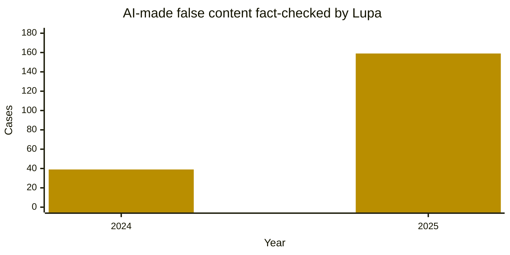
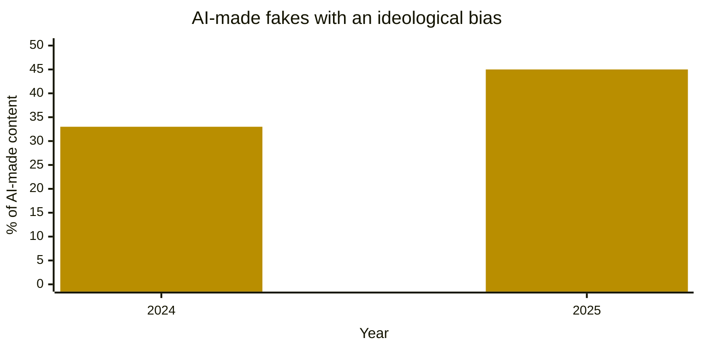
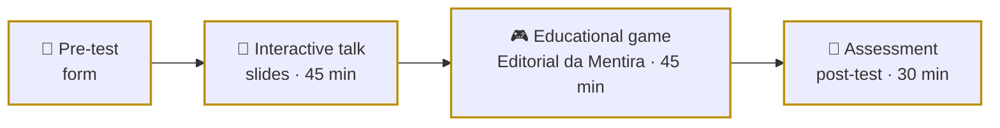

<div align="center">

# 📰 Fighting Fake News: The Editorial of Lies

> 🌐 Leia em [Português](./README.md)

<a href="#-misinformation-in-numbers"></a>

[](#️-technologies-used)

[](https://daviperrelli15.github.io/editorial-da-mentira/)
[](#️-the-workshop-at-ete-janga)
[](#-the-project-and-the-course)
[](./LICENSE)

`Extension project · Systems Development at UNINASSAU Olinda · game in HTML, CSS and JavaScript · MIT`

**[🎮 Play now](https://daviperrelli15.github.io/editorial-da-mentira/)** &nbsp;·&nbsp; **[📄 Paper](./docs/artigo-pex54-grupo10.pdf)** &nbsp;·&nbsp; **[🖥️ Slides](./docs/slides-combate-as-fake-news.pdf)** &nbsp;·&nbsp; **[📝 Form](https://forms.gle/QLrKfqEV7TuaX99x8)** &nbsp;·&nbsp; **[📍 Venue](https://www.google.com/maps/search/?api=1&query=Escola+T%C3%A9cnica+Estadual+Jos%C3%A9+Alencar+Gomes+da+Silva%2C+Rua+Jo%C3%A3o+Francisco+Batista%2C+170%2C+Janga%2C+Paulista+-+PE%2C+53439-410)**

</div>

University extension project by Group 10 of the Systems Analysis and Development course at UNINASSAU (Shopping Patteo Olinda campus) that teaches technical high school students at ETE Janga to spot fake news before sharing it: a talk, a digital game made by the group and an assessment before and after. **Ready for the Nov 24, 2026 workshop:** paper, slides, published game and assessment form; the pre-test and post-test results go into the final report (PEX-56). The game and the documents are in Portuguese.

---

## 📑 Table of Contents

- [🗂️ Project Structure](#️-project-structure)
- [🗂️ Project Structure - tree](#️-project-structure---tree)
- [📚 The project and the course](#-the-project-and-the-course)
- [📊 Misinformation in numbers](#-misinformation-in-numbers)
- [🗓️ The workshop at ETE Janga](#️-the-workshop-at-ete-janga)
- [🎮 The game: Editorial da Mentira](#-the-game-editorial-da-mentira)
- [👥 Team](#-team)
- [⚙️ Technologies used](#️-technologies-used)
- [🚀 How to run](#-how-to-run)
- [🤝 Contributing](#-contributing)
- [📄 License](#-license)

---

## 🗂️ Project Structure

| Path | Description |
|---|---|
| `index.html` | The game's single page: start screen, status bar, the 3 columns (headquarters and bills · newsroom · stickers and backstage), mobile tabs and the mini-game windows. Opens with a double click, no build |
| `docs/` | The project's 3 documents: the paper as `.docx` and `.pdf` and the workshop slides as `.pdf` (see [Documents](#-the-project-and-the-course)) |
| `assets/` | Animated banner of this README, in Portuguese (`banner-jornal.svg`) and in English (`banner-jornal.en.svg`): newspaper pages falling, "FAKE" stamps flashing and the project's three phrases, animated with CSS only |
| `img/banca1.webp` … `img/banca10.webp` | Photos of the 10 Gazeta da Manhã headquarters, one per game level, as WebP 1056×792 (4:3 crop showing the building's sign) |
| `img/adesivos/` | The 7 editing stickers created by the team (WebP with transparent background) |
| `img/qrcode-forms.svg` | QR Code of the assessment form, the same one as on slide 16 |
| `css/` | Game styles in 4 files: base (colors and buttons), layout (fixed screen, 3 columns and tabs), components and overlays (mini-games and endings) |
| `js/config.js` | Every balance number in the game, each one with its reason in a comment |
| `js/assets.js` | Names and photos of the 10 headquarters levels and the sticker paths, in one place |
| `js/core/` | Pure game rules (views, money, police, bills, crash), saving and sounds |
| `js/data/` | Headline parts and all game text |
| `js/ui/` | Interface: status bar, columns, stickers, upgrades, tabs, endings, SVG icons and illustrations |
| `js/minigames/` | The 3 mini-games: news crash, "Lie Low" maze and Evidence Shredder |
| `js/game.js` · `js/main.js` | Game controller and page startup |
| `tools/simulacao.js` | Balance simulation in Node.js: plays thousands of games with 4 player profiles and checks 7 goals |
| `LICENSE` | MIT license text |
| `README.en.md` | This summary in English |
| `README.md` | This summary in Portuguese |

---

## 🗂️ Project Structure - tree

```
🗂️
├── 📁 assets
│  ├── 🖼️ banner-jornal.en.svg
│  └── 🖼️ banner-jornal.svg
├── 📁 css
│  └── … (4 .css files)
├── 📁 docs
│  ├── 📄 artigo-pex54-grupo10.docx
│  ├── 📄 artigo-pex54-grupo10.pdf
│  └── 📄 slides-combate-as-fake-news.pdf
├── 📁 img
│  ├── 📁 adesivos
│  │  └── … (7 .webp files)
│  ├── … (10 files banca1.webp to banca10.webp)
│  └── 🖼️ qrcode-forms.svg
├── 📁 js
│  ├── 📁 core
│  │  └── … (4 .js files)
│  ├── 📁 data
│  │  └── … (2 .js files)
│  ├── 📁 minigames
│  │  └── … (3 .js files)
│  ├── 📁 ui
│  │  └── … (11 .js files)
│  ├── ⚙️ assets.js
│  ├── 🔧 config.js
│  ├── ⚙️ game.js
│  └── ⚙️ main.js
├── 📁 tools
│  └── 🧪 simulacao.js
├── 🌐 index.html
├── 🗒️ LICENSE
├── 🇺🇸 README.en.md
└── 🇧🇷 README.md
```

---

## 📚 The project and the course

**Fake News: Learning to Spot Them So You Don't Share Them** (*Fake News: Aprender a Identificar para Não Compartilhar*) is Group 10's intervention project for the course **Interdisciplinary Practical Extension Activities I (APIEXT I)**, document PEX-54, in the Systems Analysis and Development program at UNINASSAU. In extension work the university acts as an agent of social change (FORPROEX, 2012): here that becomes a media literacy and fact-checking workshop in the public school system, aligned with SDG 4 (Quality Education) and SDG 16 (Peace, Justice and Strong Institutions) of the 2030 Agenda (UN, 2015).

**Why Janga.** In the Janga neighborhood (Paulista, Pernambuco), many students go online through *zero-rating* plans: WhatsApp, Instagram and Facebook don't use data, but Google, news sites and fact-checking sites do. As slide 3 puts it: the lie travels for free, the truth costs data.

**What misinformation is.** The project uses Wardle and Derakhshan's (2017) taxonomy, where the difference lies in intent, not only in content:

| Type | What it is | Example (slide 4) |
|---|---|---|
| *Misinformation* | A mistake without bad intent | An aunt forwards a chain message thinking it's true |
| *Disinformation* | A lie made on purpose | Someone builds a fake story to deceive, profit or run a scam |
| *Malinformation* | Truth used to harm | Leaking a real screenshot or someone's data to expose and humiliate them |

All of this happens in the post-truth era, where emotion speaks louder than facts (D'Ancona, 2018). The proposed answer is UNESCO's Media and Information Literacy, in 3 steps: **stop**, **check** and **decide**.

**General goal:** to train technical high school students in media literacy and fact-checking, raising awareness of the risks of *fake news*, *deepfakes* and information disorders.

**Documents**

| Document | File | What's in it |
|---|---|---|
| 📄 Paper (intervention project) | [`artigo-pex54-grupo10.pdf`](./docs/artigo-pex54-grupo10.pdf) · [`.docx`](./docs/artigo-pex54-grupo10.docx) | Introduction, goals, area description, venue and audience, methods, expected results, schedule and references (12 pages) |
| 🖥️ Workshop slides | [`slides-combate-as-fake-news.pdf`](./docs/slides-combate-as-fake-news.pdf) | The 18 "Combate às Fake News" slides, in 4 blocks: local context, misinformation and AI, the solution and the game, citizenship and assessment |

> [!NOTE]
> The paper was written with the previous version of the game: Figure 2 and the text of the second stage mention days, "from the Shack to the Mansion" and a "food" bill. The current game uses weeks, the 10 Gazeta da Manhã headquarters and a Groceries bill, and slides 11, 12 and 13 already show the current version.

---

## 📊 Misinformation in numbers

The data that opens the workshop (slides 6, 8 and 9), checked against the sources cited in the paper.

**AI-made fakes exploded in one year** · source: [Agência Lupa (2026)](https://www.agencialupa.org/noticias/2026/02/05/fakes-com-ia-crescem-308-em-um-ano-revela-estudo-inedito-da-lupa/)



<sub>From 39 to 159 cases: +308% (slide 6). In 2025, 1 in every 4 of Lupa's fact-checks (25%) was already about AI-made content, and more than three quarters of that content used the face or voice of well-known people.</sub>

**In an election year, lies become strategy** · source: [Agência Lupa (2026)](https://www.agencialupa.org/noticias/2026/02/05/fakes-com-ia-crescem-308-em-um-ano-revela-estudo-inedito-da-lupa/)



<sub>Almost 45% in 2025, against 33% in 2024 (slide 8): attacks on candidates from every side, fear in times of crisis and family fights.</sub>

**The real impact in low-income neighborhoods** · source: [CalangoLab (2026), via Desinformante](https://desinformante.com.br/relatorio-desinformacao-afeta-vida-nas-periferias/)

| 📱 Have received misinformation | 🔁 The lie changed what the person did | 🔍 Never check | 🗣️ People interviewed |
|:---:|:---:|:---:|:---:|
| **over 77%** | **1 in every 4 cases** | **almost 1 in 4** | **404** (9 neighborhoods of Vitória, ES) |

<sub>Slide 9: a child who skipped school, people who missed work, a missed doctor's appointment and a fake curfew.</sub>

<details>
<summary>📋 See every number with its source</summary>

| Number | What it measures | Source |
|---|---|---|
| +308% | Growth of AI-made fakes, from 2024 to 2025 | Agência Lupa (2026) |
| 39 → 159 | AI-made false content cases fact-checked by Lupa (2024 → 2025) | Agência Lupa (2026) |
| 4.6% → 25% | Share of Lupa's fact-checks that were about AI-made content (2024 → 2025) | Agência Lupa (2026) |
| over 75% | AI-made content in 2025 using the face or voice of well-known people | Agência Lupa (2026) |
| 33% → almost 45% | AI-made content with an ideological bias (2024 → 2025) | Agência Lupa (2026) |
| over 77% | Residents interviewed in low-income neighborhoods of Vitória (ES) who have received misinformation | CalangoLab (2026) |
| 1 in 4 | Cases in which misinformation changed what the person did | CalangoLab (2026) |
| almost 1 in 4 | People who never check whether information is true | CalangoLab (2026) |
| 404 | Residents interviewed, in 9 neighborhoods and communities | CalangoLab (2026) |

</details>

---

## 🗓️ The workshop at ETE Janga

Two hours in the school's multimedia room, always in this order:



<sub>The pre-test opens the first stage and the post-test closes the third, with the same questions: comparing them shows how much the class improved.</sub>

| When | Where | Who takes part |
|---|---|---|
| Nov 24, 2026 | Escola Técnica Estadual José Alencar Gomes da Silva (ETE Janga), Rua João Francisco Batista, 170, Janga, Paulista – PE, ZIP 53439-410 · [open in Google Maps](https://www.google.com/maps/search/?api=1&query=Escola+T%C3%A9cnica+Estadual+Jos%C3%A9+Alencar+Gomes+da+Silva%2C+Rua+Jo%C3%A3o+Francisco+Batista%2C+170%2C+Janga%2C+Paulista+-+PE%2C+53439-410) | 3rd-year technical high school students, Business Administration and Graphic Design courses |

**Assessment form.** Point the phone camera at the QR Code, choose "Pré-teste" (pre-test) or "Pós-teste" (post-test) and answer (about 3 minutes, anonymous). It is the same QR as on slide 16.

<p align="center">
  <a href="https://forms.gle/QLrKfqEV7TuaX99x8"></a><br/>
  <sub><a href="https://forms.gle/QLrKfqEV7TuaX99x8">forms.gle/QLrKfqEV7TuaX99x8</a></sub>
</p>

---

## 🎮 The game: Editorial da Mentira

**[Play in the browser](https://daviperrelli15.github.io/editorial-da-mentira/)**, nothing to install. You are the editor of the Gazeta da Manhã and you play **as the one who makes fake news**, to learn the tricks from the inside: those who know the trick fall for it less.

1. Build a dull headline (who, action and topic).
2. Slap on stickers: each one is a real misinformation trick.
3. Publish and print before the crash: if it falls, the story gets debunked.
4. Pay the week's bills. If Police Attention hits 100%, the Federal Police knocks on the door.

| Sticker | In real life (slide 12) |
|---|---|
| Sensacionalismo (Sensationalism) | Exaggerated words to scare you |
| Teoria da conspiração (Conspiracy theory) | "What they're hiding from you" |
| Caça-clique (Clickbait) | A title that promises and doesn't deliver |
| Especialista anônimo (Anonymous expert) | A source nobody can check |
| Compartilhe agora (Share now) | Rushing you so you don't think |
| Culpa dos alienígenas (Blame the aliens) | An absurd explanation for everything |
| Cura milagrosa (Miracle cure) | A false health promise (dangerous) |

Besides the news crash, there are two more mini-games: the **Ficar na Miúda** (Lie Low) maze, to escape the police, and the **Queima de Arquivo** (Evidence Shredder), to erase Chief Amaral's clues. The paper grows through 10 headquarters, each named after the sign on its building: from Jornal Local to Sede Global. The workshop challenge (slide 13) is to reach the **Redação de Bairro** without getting arrested.

---

## 👥 Team

Group 10 · Systems Analysis and Development · UNINASSAU, Shopping Patteo Olinda campus.

| Member | GitHub |
|---|---|
| Carlos Abreu | [carloshenrique1611](https://github.com/carloshenrique1611) |
| Davi Perrelli | [DaviPerrelli15](https://github.com/DaviPerrelli15) |
| David Brian | [briandevbr](https://github.com/briandevbr) |
| Gabriel Vereda | |
| Guilherme Cauã | |
| Guilherme Nunes | |
| Miguel Arthur | [miguelarthur202](https://github.com/miguelarthur202) |
| Rayanne Melo | |
| Renato Oliveira | |

---

## ⚙️ Technologies used

- [HTML](https://developer.mozilla.org/en-US/docs/Web/HTML), [CSS](https://developer.mozilla.org/en-US/docs/Web/CSS) and [JavaScript](https://developer.mozilla.org/en-US/docs/Web/JavaScript): the whole game, as classic scripts with no build, so it opens with a double click
- [Canvas API](https://developer.mozilla.org/en-US/docs/Web/API/Canvas_API): the 3 mini-games
- [SVG](https://developer.mozilla.org/en-US/docs/Web/SVG): icons, story illustrations and Chief Amaral's portrait, made for the project
- [Web Audio API](https://developer.mozilla.org/en-US/docs/Web/API/Web_Audio_API): sound effects generated in the browser
- [Web Storage (`localStorage`)](https://developer.mozilla.org/en-US/docs/Web/API/Window/localStorage): save and continue
- [Google Fonts](https://fonts.google.com/): Barlow, Barlow Condensed, Playfair Display, UnifrakturMaguntia and Caveat
- [Node.js](https://nodejs.org/en): only to run the balance simulation
- [Google Forms](https://forms.gle/QLrKfqEV7TuaX99x8): pre-test and post-test questionnaire
- [GitHub Pages](https://pages.github.com/): hosts the game

---

## 🚀 How to run

**Just want to play?** Open the [published version](https://daviperrelli15.github.io/editorial-da-mentira/), built from `main`. Nothing to install.

**Want to run it and change the code?** Prerequisites: [Git](https://git-scm.com/) and an up-to-date browser; for the simulation, [Node.js](https://nodejs.org/en).

```bash
git clone https://github.com/DaviPerrelli15/editorial-da-mentira.git
cd editorial-da-mentira
```

Then just double-click `index.html`. On a phone (or a window narrower than 900 px), the 3 columns become tabs at the bottom: Redação, Adesivos, Contas and Bastidores. Without internet, the game uses the system's fallback fonts.

To check the balance after changing `js/config.js`:

```bash
node tools/simulacao.js
```

---

## 🤝 Contributing

The game and the documents belong to Group 10. Ideas and bug reports are welcome via [issues](https://github.com/DaviPerrelli15/editorial-da-mentira/issues); to propose a code change, fork, create a branch and open a Pull Request to `main`.

---

## 📄 License

The code is under the [MIT](./LICENSE) license: use, study and adapt freely, keeping the copyright notice. The banner was made for the project and follows the same license. The documents in `docs/` are Group 10's academic work and carry logos of UNINASSAU and of the Ser Educacional group, which belong to those institutions. Google Fonts typefaces follow their own authors' licenses (SIL Open Font License).

---

<div align="center">
  <sub>Made by Group 10 💛 · PEX-54 · Systems Analysis and Development · UNINASSAU Olinda</sub><br/>
  <sub>Stop → Check → Decide</sub>
</div>
