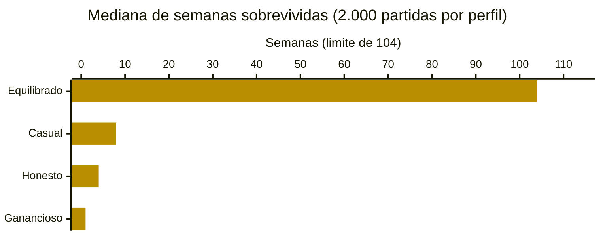
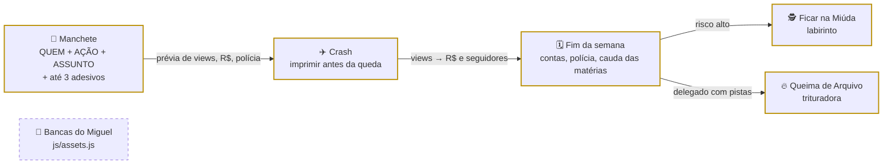

<div align="center">

# 📰 Editorial da Mentira

> 🌐 Read this in [English](./README.en.md)

[](#-como-funciona)

[](#️-tecnologias-usadas)

[](https://daviperrelli15.github.io/editorial-da-mentira/)
[](./LICENSE)
[](#-projeto-em-números)
[](#-time-e-contexto)
[](https://github.com/DaviPerrelli15/editorial-da-mentira/commits/main)

`HTML · CSS · JavaScript puro · sem build · 3 minijogos · MIT`

**[🌐 Abrir a versão web](https://daviperrelli15.github.io/editorial-da-mentira/)**

</div>

Jogo de navegador em que você é o editor da **Gazeta da Manhã**: monta manchetes, cola adesivos sensacionalistas para lucrar e tenta pagar as contas da semana sem que o **Delegado Amaral** junte provas suficientes para te prender. **Jogável do começo ao fim:** semanas e meses, contas com vencimento próprio, crash da notícia, labirinto do "Ficar na Miúda", Queima de Arquivo, upgrades e 6 finais diferentes; as imagens das bancas de jornal estão em produção e entram trocando uma linha.

> [!TIP]
> **Quer mexer no balanceamento?** Todos os números do jogo estão em [`js/config.js`](./js/config.js), cada um com o motivo comentado. Depois de mudar, rode `node tools/simulacao.js` para ver se o jogo continua equilibrado (ver [Testes](#-testes)).

---

## 📑 Sumário

- [🗂️ Estrutura do Projeto](#️-estrutura-do-projeto)
- [🗂️ Estrutura do Projeto - tree](#️-estrutura-do-projeto---tree)
- [👥 Time e contexto](#-time-e-contexto)
- [📊 Projeto em números](#-projeto-em-números)
- [🔄 Como funciona](#-como-funciona)
- [🗄️ Modelo de dados](#️-modelo-de-dados)
- [📰 Regras de Negócio](#-regras-de-negócio)
- [🧪 Testes](#-testes)
- [⚙️ Tecnologias usadas](#️-tecnologias-usadas)
- [🚀 Como rodar](#-como-rodar)
- [🤝 Contribuindo](#-contribuindo)
- [📄 Licença](#-licença)

---

## 🗂️ Estrutura do Projeto

| Caminho | Descrição |
|---|---|
| `index.html` | Única página do jogo: tela inicial, barra de status, as 3 colunas (casa e contas · redação · adesivos e bastidores), abas do celular e as janelas dos minijogos. Carrega os scripts em ordem, sem módulos, para abrir com dois cliques |
| `css/base.css` | Tokens de cor e fonte, reset, botões, ícones e foco visível |
| `css/layout.css` | Tela fixa, barra de status, grade de 3 colunas com rolagem própria e as abas do celular (abaixo de 900 px) |
| `css/components.css` | Polaroid do imóvel, Delegado Amaral, post-its das contas, jornal, montador de manchete, previsão, feed, adesivos e upgrades |
| `css/overlays.css` | Diálogos, cartões dos minijogos, telas de final e a sequência da prisão |
| `js/config.js` | Todos os números de balanceamento num objeto só (`EDM.CONFIG`), com comentário do porquê de cada valor |
| `js/assets.js` | Caminhos das imagens num lugar só: tema `casas` (atual) e tema `bancas` (pronto para as imagens novas) |
| `js/core/rules.js` | Regras puras, sem DOM: views, dinheiro, polícia, pistas, contas, crash, upgrades, fim de semana e eventos. É o mesmo código que a simulação usa |
| `js/core/util.js` | Sorteio com semente, formatação em pt-BR (R$, "1,2 mil") e utilitários numéricos |
| `js/core/storage.js` | Salvar/continuar, recorde e preferência de som no `localStorage`, protegido para modo anônimo |
| `js/core/audio.js` | Efeitos sonoros sintetizados com Web Audio (o projeto não tem arquivos de áudio) |
| `js/data/news.js` | Partes da manchete (QUEM · AÇÃO · ASSUNTO) com nível de absurdo e a função que monta o texto com prefixos e sufixos dos adesivos |
| `js/data/content.js` | Textos do jogo: adesivos, contas, finais, eventos, narrador, comentários, falas do delegado e upgrades |
| `js/ui/` | Interface dividida por responsabilidade: barra de status, coluna esquerda, redação, adesivos, upgrades, abas, finais, diálogos, ícones SVG e ilustrações SVG |
| `js/minigames/crash.js` | Crash da notícia: aviãozinho de jornal em canvas, ponto de queda sorteado antes da decolagem |
| `js/minigames/maze.js` | Labirinto do "Ficar na Miúda": guardas com cone de visão, perseguição com BFS, teclado, direcional e arrastar no celular |
| `js/minigames/shredder.js` | Queima de Arquivo: triturar as provas que caem antes que cheguem à mesa do delegado |
| `js/game.js` | Controlador: guarda o estado da partida, chama as regras, abre os minijogos e redesenha a tela |
| `js/main.js` | Inicialização: ícones, eventos e tela inicial |
| `img/adesivos/` | Os 7 adesivos personalizados do time (WebP com fundo transparente) |
| `img/bancas/` | Hoje só tem o `LEIA-ME.txt`: é onde entram as 10 imagens das bancas de jornal |
| `img/casa1.jpg` … `img/casa10.jpg` | Fotos dos 10 níveis de casa, usadas enquanto o tema `bancas` não é ativado |
| `tools/simulacao.js` | Simulação de balanceamento em Node.js: joga milhares de partidas com 4 perfis de jogador e confere 7 metas |
| `LICENSE` | Texto da licença MIT do projeto |
| `README.en.md` | Esta documentação em inglês |
| `README.md` | Esta documentação em português |

---

## 🗂️ Estrutura do Projeto - tree

```
🗂️
├── 📁 css
│  ├── 🎨 base.css
│  ├── 🎨 components.css
│  ├── 🎨 layout.css
│  └── 🎨 overlays.css
├── 📁 img
│  ├── 📁 adesivos
│  │  └── … (7 arquivos .webp)
│  ├── 📁 bancas
│  │  └── 📄 LEIA-ME.txt
│  └── … (10 arquivos casa1.jpg a casa10.jpg)
├── 📁 js
│  ├── 📁 core
│  │  ├── ⚙️ audio.js
│  │  ├── ⚙️ rules.js
│  │  ├── ⚙️ storage.js
│  │  └── ⚙️ util.js
│  ├── 📁 data
│  │  ├── ⚙️ content.js
│  │  └── ⚙️ news.js
│  ├── 📁 minigames
│  │  ├── ⚙️ crash.js
│  │  ├── ⚙️ maze.js
│  │  └── ⚙️ shredder.js
│  ├── 📁 ui
│  │  └── … (11 arquivos .js)
│  ├── ⚙️ assets.js
│  ├── 🔧 config.js
│  ├── ⚙️ game.js
│  └── ⚙️ main.js
├── 📁 tools
│  └── 🧪 simulacao.js
├── 🌐 index.html
├── 🗒️ LICENSE
├── 🇺🇸 README.en.md
└── 🇧🇷 README.md
```

---

## 👥 Time e contexto

Jogo criado por um time de três pessoas. O time define a direção criativa, testa e organiza a lista de mudanças de cada versão (dividida em **Sistema** e **Estilo**), cria a arte própria (como os adesivos e as bancas de jornal) e publica o jogo no GitHub Pages.

### 🌟 Quem constrói o Editorial da Mentira

<table>
  <tr>
    <td align="center" width="20%"><a href="https://github.com/DaviPerrelli15"><br/><b>Davi Perrelli</b></a><br/><sub>🎮 concepção, testes e publicação</sub></td>
    <td align="center" width="20%"><a href="https://github.com/carloshenrique1611"><br/><b>Carlos Henrique</b></a><br/><sub>🎮 concepção, testes e curadoria</sub></td>
    <td align="center" width="20%"><a href="https://github.com/miguelarthur202"><br/><b>Miguel Arthur</b></a><br/><sub>🎨 arte das bancas de jornal</sub></td>
  </tr>
</table>

---

## 📊 Projeto em números

| 📰 Manchetes possíveis | 🏷️ Adesivos | 🎮 Minijogos | 🧾 Contas | 🛠️ Upgrades |
|:---:|:---:|:---:|:---:|:---:|
| **2.808** (13 × 12 × 18) | **7** (3 combos secretos) | **3** | **5** (5 finais + prisão) | **16** (+ 10 níveis de imóvel) |

**Quanto tempo cada estilo de jogador sobrevive**



<sub>Resultado de `node tools/simulacao.js 2000 104` em 06/11/2026. O equilibrado bate no limite de 104 semanas (2 anos de jogo); mesmo assim, 29,8% dessas partidas terminam antes. Os 4 perfis estão explicados em [Testes](#-testes).</sub>

<details>
<summary>📋 Ver os números dos gráficos em tabela</summary>

| Perfil | Mediana de semanas | Chegou à semana 26 | Chegou à semana 104 | Final mais comum |
|---|---:|---:|---:|---|
| Equilibrado | 104 | 78,9% | 70,2% | sobreviveu (70,1%) · aluguel (12,5%) |
| Casual | 8 | 0,5% | 0,0% | prisão (83,2%) |
| Honesto | 4 | 0,0% | 0,0% | compras (99,8%) |
| Ganancioso | 1 | 0,0% | 0,0% | prisão (100%) |

</details>

---

## 🔄 Como funciona



<sub>Borda amarela = já existe no código · borda tracejada = próxima etapa (imagens em produção; o código já está pronto)</sub>

Toda semana você tem 3 ações. Cada publicação passa pelo **crash**: o multiplicador de views sobe sem parar e o ponto de queda já foi sorteado antes da decolagem, com `P(queda ≥ x) = 0,94 ÷ x`. Imprimiu antes: a matéria rende `views × multiplicador`. Caiu: ela é desmentida, rende só 35% e, se tinha adesivo, chama mais polícia. A **reputação** multiplica as views por `0,5 + reputação/100` e decide quantos leitores viram seguidores; as views viram dinheiro pelo RPM do [`js/config.js`](./js/config.js).

O **Delegado Amaral** só ganha pista quando você perde um minijogo (labirinto ou Queima de Arquivo), nunca por sorte. Cada pista faz a polícia subir 20% mais rápido e coloca mais um guarda no labirinto; com 2 pistas, o próprio delegado entra no labirinto.

A prévia que aparece embaixo do jornal sai da mesma função que aplica a publicação (`EDM.Rules.evaluateDraft`). Saída real (Node.js 22) para a manchete "O síndico anuncia que vai chover no domingo.", no estado inicial:

```text
sem adesivo                                   → 577 views · R$ 14  · polícia +0%  · reputação +3
Sensacionalismo                               → 692 views · R$ 51  · polícia +5%  · reputação 0
Sensacionalismo + Especialista Anônimo        → 726 views · R$ 78  · polícia +6%  · reputação 0
Especialista Anônimo + Cura Milagrosa (combo) → 905 views · R$ 113 · polícia +12% · reputação −7
```

E o sorteio do crash, conferido em 100 mil voos (`EDM.Rules.drawCrashPoint` com semente 42):

```text
passa de x1,5 → 62,9%  (teoria 62,7%)
passa de x2   → 47,3%  (teoria 47,0%)
passa de x5   → 18,9%  (teoria 18,8%)
passa de x10  →  9,3%  (teoria  9,4%)
```

---

## 🗄️ Modelo de dados

O jogo não tem servidor: a partida fica no `localStorage` do navegador, em três chaves.

| Chave | O que guarda |
|---|---|
| `edm_save_v3` | O estado inteiro da partida em JSON (salvo a cada ação) |
| `edm_record_weeks` | O recorde de semanas sobrevividas |
| `edm_sound` | `on` ou `off` |

**`edm_save_v3`**: objeto criado por `EDM.Rules.createState()`.

| Campo | Tipo no arquivo | Exemplo | Observação |
|---|---|---|---|
| `version` | número | `3` | Save de outra versão é ignorado (não quebra o jogo) |
| `week` | número | `1` | Semana atual; 4 semanas = 1 mês de contas |
| `actions` | número | `3` | Ações restantes na semana |
| `money` | número | `300` | Dinheiro em caixa (R$) |
| `followers` | número | `40` | Seguidores |
| `reputation` | número | `15` | 0 a 100 (Baixa até 34, Média até 69, Alta acima) |
| `police` | número | `0` | Atenção policial, 0 a 100; em 100 a Polícia Federal bate na porta |
| `clues` | número | `0` | Pistas do delegado, 0 a 3 |
| `property` | número | `1` | Nível da casa/banca, 1 a 10 |
| `upgrades` | objeto | `{"camera": 2}` | Nível comprado de cada upgrade |
| `bills` | lista | `{"id": "internet", "owed": 130, "dueWeek": 1, "lateWeeks": 0}` | Uma entrada por conta: valor devido, semana de vencimento e semanas de atraso |
| `posts` | lista | `{"id": 1, "text": "...", "views": 657, "tailLeft": 3, ...}` | Publicações no ar (rendem por mais 3 semanas) |
| `archive` | lista | | Até 20 matérias antigas (o evento "Fantasma do passado" pode trazer de volta) |
| `crashHistory` | lista | `[1.31, 7.4]` | Últimos 10 pontos de queda do crash |
| `shredCooldown` | número | `0` | Semanas até poder usar a Queima de Arquivo de novo |
| `stats` | objeto | `{"weeks": 0, "publications": 0, ...}` | Números da tela de final |
| `over` | texto ou `null` | `"aluguel"` | Qual final aconteceu |

- **Cobertura:** a partida inteira; recarregar a página e clicar em **Continuar** volta exatamente de onde parou.
- **Peculiaridade:** a manchete que está sendo montada (partes e adesivos) não é salva; ao continuar, o jogo sorteia uma nova.

---

## 📰 Regras de Negócio

Lista de mudanças do time (PDF "Editorial da Mentira"), parte **Sistema**:

- **RN01:** trocar o sistema de dias por semanas.
- **RN02:** deixar a tela fixa (sem rolar a página inteira).
- **RN03:** uma barra de rolagem para cada uma das 3 seções da tela.
- **RN04:** balancear o "Ficar na Miúda".
- **RN05:** sistema de "crash" de notícia, baseado no minijogo do aviãozinho.
- **RN06:** balancear o valor das contas (aumentar).
- **RN07:** notícia base (sem adesivos) não pode render um dinheiro bom.
- **RN08:** notícia sem adesivo não sobe a barra de polícia.
- **RN09:** começar o jogo com a reputação baixa.
- **RN10:** reputação influencia a quantidade de visualizações, e visualização vira dinheiro.
- **RN11:** ligar reputação com seguidores, com um cálculo claro.
- **RN12:** sistema de upgrades.
- **RN13:** contas de energia e água.
- **RN14:** trocar o nome "Comida" para "Compras".
- **RN15:** um final diferente para cada conta atrasada.
- **RN16:** pagamento manual das contas, com vencimento realista.
- **RN17:** minigame no "Ficar na Miúda", baseado no jogo do labirinto.
- **RN18:** se o jogador perder o minigame do "Ficar na Miúda", o delegado ganha uma pista.
- **RN19:** retirar as pistas aleatórias que o delegado ganha.
- **RN20:** trocar o fundo da foto da notícia de acordo com o assunto dela.
- **RN21:** mais notícias, de preferência cômicas.
- **RN22:** minijogo para ativar estrategicamente.
- **RN23:** os minijogos interferem no detetive/delegado.

Parte **Estilo**: barra de status igual à referência, adesivos personalizados, uma imagem para cada notícia, troca das casas por bancas de jornal, ícone do delegado e ícones da barra de status caprichados.

Todas estão implementadas. As regras numéricas (RN04 a RN11, RN15, RN16) vivem em [`js/core/rules.js`](./js/core/rules.js) com os valores em [`js/config.js`](./js/config.js); RN05, RN17 e RN22 são os três arquivos de [`js/minigames/`](./js/minigames/). Para a RN22 (texto ambíguo no PDF), a interpretação implementada é a **Queima de Arquivo**: você escolhe quando usar (1 ação, recarga de 3 semanas) e, se triturar as provas, o delegado perde uma pista. A troca para as bancas (Estilo) depende só das imagens: os caminhos estão em [`js/assets.js`](./js/assets.js).

---

## 🧪 Testes

A simulação joga partidas automáticas com as **mesmas regras do jogo** (ela carrega `config.js` e `rules.js`) e com 4 perfis de jogador:

| Perfil | Como joga |
|---|---|
| Honesto | Só publica notícia sem adesivo |
| Ganancioso | Sempre 3 adesivos de maior lucro e espera o crash chegar em x3 |
| Casual | Escolhas aleatórias; foge da polícia de vez em quando |
| Equilibrado | Controla o risco por semana, foge no labirinto quando a polícia passa de 50%, usa a Queima de Arquivo com 2 pistas e investe em reputação |

```bash
node tools/simulacao.js            # 2.000 partidas por perfil, até 104 semanas
node tools/simulacao.js 5000 52    # partidas por perfil, semanas máximas
```

Saída real (Node.js 22, 2.000 partidas por perfil), trecho final:

```text
▶ EQUILIBRADO (2000 partidas)
  semanas sobrevividas: p10 8 · mediana 104 · p90 104
  chegou à semana 8: 96.2% · 26: 78.9% · 52: 73.5% · 104: 70.2%
  imóvel final (mediana): nível 10 · p90 nível 10 · seguidores (mediana) 237.885

METAS
  [OK]    Notícia honesta não paga as contas (honesto quebra antes da semana 16)
  [OK]    Honesto nunca é preso (sem adesivo não há polícia)
  [OK]    Ganância é punida (ganancioso preso antes da semana 10)
  [OK]    Jogar no automático não basta (casual: mediana < 26 semanas)
  [OK]    Jogo é vencível com cuidado (equilibrado: mediana ≥ 40 semanas)
  [OK]    Jogo não é fácil demais (equilibrado: no máx. 75% chegam à semana 104)
  [OK]    Equilibrado progride (mediana do imóvel ≥ nível 5)
```

O comando termina com código 1 se alguma meta falhar, então dá para usar como checagem antes de publicar uma mudança de balanceamento.

---

## ⚙️ Tecnologias usadas

- [HTML](https://developer.mozilla.org/pt-BR/docs/Web/HTML): estrutura da página única, com botões e diálogos acessíveis
- [CSS](https://developer.mozilla.org/pt-BR/docs/Web/CSS): layout em grid com 3 colunas de rolagem própria, abas no celular, tema escuro com papel de jornal
- [JavaScript](https://developer.mozilla.org/pt-BR/docs/Web/JavaScript): regras, interface e minijogos, em scripts clássicos com o namespace `EDM` (sem módulos, para abrir com dois cliques)
- [Canvas API](https://developer.mozilla.org/pt-BR/docs/Web/API/Canvas_API): os três minijogos
- [SVG](https://developer.mozilla.org/pt-BR/docs/Web/SVG): ícones da interface, ilustrações das notícias, retrato do delegado e artes dos finais, todos feitos para o projeto
- [Web Audio API](https://developer.mozilla.org/pt-BR/docs/Web/API/Web_Audio_API): efeitos sonoros gerados no navegador
- [Web Storage (`localStorage`)](https://developer.mozilla.org/pt-BR/docs/Web/API/Window/localStorage): salvar e continuar, recorde e som
- [Google Fonts](https://fonts.google.com/): [Barlow](https://fonts.google.com/specimen/Barlow), [Barlow Condensed](https://fonts.google.com/specimen/Barlow+Condensed), [Playfair Display](https://fonts.google.com/specimen/Playfair+Display), [UnifrakturMaguntia](https://fonts.google.com/specimen/UnifrakturMaguntia) e [Caveat](https://fonts.google.com/specimen/Caveat)
- [Node.js](https://nodejs.org/pt): só para rodar a simulação de balanceamento (o jogo não precisa dele)
- [GitHub Pages](https://pages.github.com/): hospeda a versão web

---

## 🚀 Como rodar

**Só quer ver?** Abra a [versão web](https://daviperrelli15.github.io/editorial-da-mentira/). Não precisa instalar nada.

**Quer rodar e mexer no código?** Pré-requisitos: [Git](https://git-scm.com/) e um navegador atualizado. Para a simulação, [Node.js](https://nodejs.org/pt).

```bash
git clone https://github.com/DaviPerrelli15/editorial-da-mentira.git
cd editorial-da-mentira
```

Depois é só abrir o `index.html` com dois cliques: não tem build nem dependência. Aparece a tela inicial com **Novo jogo** e **Como jogar**. No celular (ou janela com menos de 900 px), o jogo troca as 3 colunas por abas embaixo: Redação, Adesivos, Contas e Bastidores.

As fontes vêm do Google Fonts, então sem internet o jogo funciona com fontes de reserva do sistema. Se preferir um servidor local:

```bash
python3 -m http.server 8000
# depois abra http://localhost:8000
```

---

## 🤝 Contribuindo

Para sugerir uma mudança: faça um fork, crie uma branch, mude e abra um Pull Request para a `main`. Se a mudança mexer em números, rode `node tools/simulacao.js` e cole o bloco **METAS** na descrição do PR.

Ideias e bugs são bem-vindos via [issues](https://github.com/DaviPerrelli15/editorial-da-mentira/issues).

---

## 📄 Licença

Distribuído sob a licença [MIT](./LICENSE): use, estude e adapte à vontade, mantendo o aviso de copyright. As fontes do Google Fonts seguem as licenças dos próprios autores (SIL Open Font License).

---

<div align="center">
  <sub>Feito pelo time do Editorial da Mentira 💛 · <a href="https://github.com/DaviPerrelli15">Davi Perrelli</a>, <a href="https://github.com/carloshenrique1611">Carlos Henrique</a> e <a href="https://github.com/miguelarthur202">Miguel Arthur</a></sub><br/>
  <sub>Monte a manchete → cole os adesivos → imprima antes do crash → pague as contas</sub>
</div>
