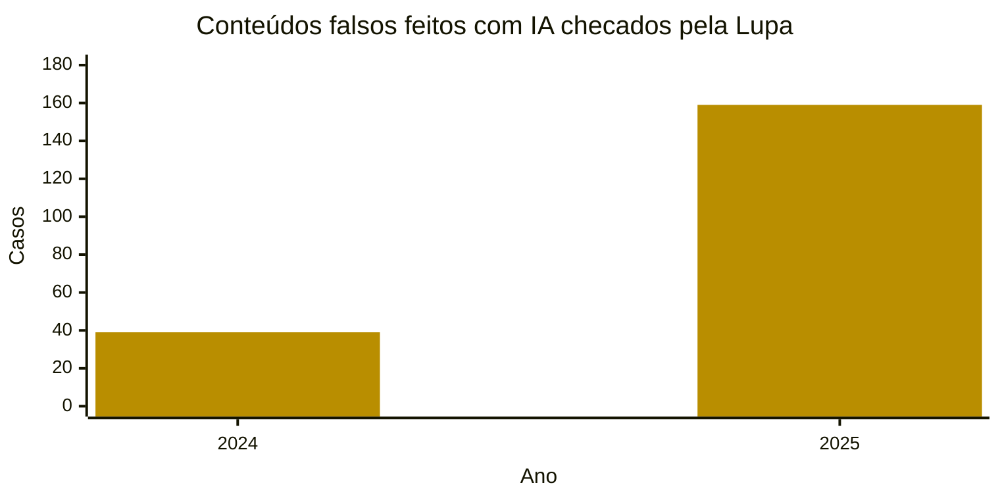
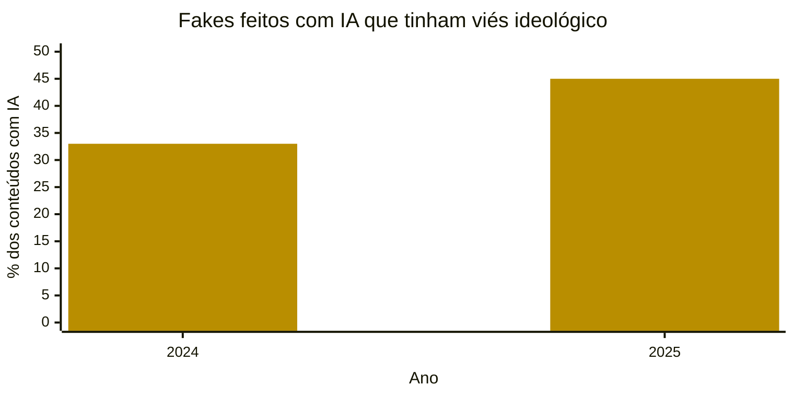
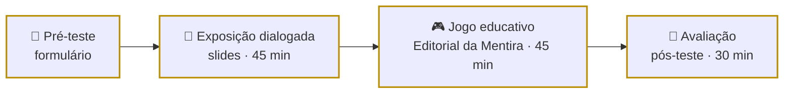

<div align="center">

# 📰 Combate às Fake News: O Editorial da Mentira

> 🌐 Read this in [English](./README.en.md)

<a href="#-a-desinformação-em-números"></a>

[](#️-tecnologias-usadas)

[](https://daviperrelli15.github.io/editorial-da-mentira/)
[](#️-a-oficina-na-ete-janga)
[](#-o-projeto-e-a-disciplina)
[](./LICENSE)

`Projeto de extensão · ADS UNINASSAU Olinda · jogo em HTML, CSS e JavaScript · MIT`

**[🎮 Jogar agora](https://daviperrelli15.github.io/editorial-da-mentira/)** &nbsp;·&nbsp; **[📄 Artigo](./docs/artigo-pex54-grupo10.pdf)** &nbsp;·&nbsp; **[🖥️ Slides](./docs/slides-combate-as-fake-news.pdf)** &nbsp;·&nbsp; **[📝 Formulário](https://forms.gle/QLrKfqEV7TuaX99x8)** &nbsp;·&nbsp; **[📍 Local](https://www.google.com/maps/search/?api=1&query=Escola+T%C3%A9cnica+Estadual+Jos%C3%A9+Alencar+Gomes+da+Silva%2C+Rua+Jo%C3%A3o+Francisco+Batista%2C+170%2C+Janga%2C+Paulista+-+PE%2C+53439-410)**

</div>

Projeto de extensão do Grupo 10 de Análise e Desenvolvimento de Sistemas da UNINASSAU (Campus Shopping Patteo Olinda) que ensina estudantes do Ensino Médio Técnico da ETE Janga a identificar fake news antes de compartilhar: uma palestra, um jogo digital feito pelo grupo e uma avaliação antes e depois. **Pronto para a oficina de 24/11/2026:** artigo, slides, jogo publicado e formulário de avaliação; os resultados do pré-teste e do pós-teste entram no relatório final (PEX-56).

---

## 📑 Sumário

- [🗂️ Estrutura do Projeto](#️-estrutura-do-projeto)
- [🗂️ Estrutura do Projeto - tree](#️-estrutura-do-projeto---tree)
- [📚 O projeto e a disciplina](#-o-projeto-e-a-disciplina)
- [📊 A desinformação em números](#-a-desinformação-em-números)
- [🗓️ A oficina na ETE Janga](#️-a-oficina-na-ete-janga)
- [🎮 O jogo: Editorial da Mentira](#-o-jogo-editorial-da-mentira)
- [👥 Equipe](#-equipe)
- [⚙️ Tecnologias usadas](#️-tecnologias-usadas)
- [🚀 Como rodar](#-como-rodar)
- [🤝 Contribuindo](#-contribuindo)
- [📄 Licença](#-licença)

---

## 🗂️ Estrutura do Projeto

| Caminho | Descrição |
|---|---|
| `index.html` | Página única do jogo: tela inicial, barra de status, as 3 colunas (sede e contas · redação · adesivos e bastidores), abas do celular e as janelas dos minijogos. Abre com dois cliques, sem build |
| `docs/` | Os 3 documentos do projeto: o artigo em `.docx` e `.pdf` e os slides da oficina em `.pdf` (ver [Documentos](#-o-projeto-e-a-disciplina)) |
| `assets/` | Banner animado deste README, em português (`banner-jornal.svg`) e em inglês (`banner-jornal.en.svg`): páginas de jornal caindo, carimbos "FAKE" piscando e as três frases do projeto, animados só com CSS |
| `img/banca1.webp` … `img/banca10.webp` | Fotos das 10 sedes da Gazeta da Manhã, uma por nível do jogo, em WebP 1056×792 (recorte 4:3 com a placa do prédio) |
| `img/adesivos/` | Os 7 adesivos de edição criados pelo time (WebP com fundo transparente) |
| `img/qrcode-forms.svg` | QR Code do formulário de avaliação, o mesmo do slide 16 |
| `css/` | Estilos do jogo em 4 arquivos: base (cores e botões), layout (tela fixa, 3 colunas e abas), componentes e sobreposições (minijogos e finais) |
| `js/config.js` | Todos os números de balanceamento do jogo, cada um com o motivo comentado |
| `js/assets.js` | Nomes e fotos dos 10 níveis de sede e o caminho dos adesivos, num lugar só |
| `js/core/` | Regras puras do jogo (views, dinheiro, polícia, contas, crash), salvamento e sons |
| `js/data/` | Partes das manchetes e todos os textos do jogo |
| `js/ui/` | Interface: barra de status, colunas, adesivos, upgrades, abas, finais, ícones e ilustrações em SVG |
| `js/minigames/` | Os 3 minijogos: crash da notícia, labirinto do "Ficar na Miúda" e Queima de Arquivo |
| `js/game.js` · `js/main.js` | Controlador da partida e inicialização da página |
| `tools/simulacao.js` | Simulação de balanceamento em Node.js: joga milhares de partidas com 4 perfis e confere 7 metas |
| `LICENSE` | Texto da licença MIT |
| `README.en.md` | Este resumo em inglês |
| `README.md` | Este resumo em português |

---

## 🗂️ Estrutura do Projeto - tree

```
🗂️
├── 📁 assets
│  ├── 🖼️ banner-jornal.en.svg
│  └── 🖼️ banner-jornal.svg
├── 📁 css
│  └── … (4 arquivos .css)
├── 📁 docs
│  ├── 📄 artigo-pex54-grupo10.docx
│  ├── 📄 artigo-pex54-grupo10.pdf
│  └── 📄 slides-combate-as-fake-news.pdf
├── 📁 img
│  ├── 📁 adesivos
│  │  └── … (7 arquivos .webp)
│  ├── … (10 arquivos banca1.webp a banca10.webp)
│  └── 🖼️ qrcode-forms.svg
├── 📁 js
│  ├── 📁 core
│  │  └── … (4 arquivos .js)
│  ├── 📁 data
│  │  └── … (2 arquivos .js)
│  ├── 📁 minigames
│  │  └── … (3 arquivos .js)
│  ├── 📁 ui
│  │  └── … (11 arquivos .js)
│  ├── ⚙️ assets.js
│  ├── 🔧 config.js
│  ├── ⚙️ game.js
│  └── ⚙️ main.js
├── 📁 tools
│  └── 🧪 simulacao.js
├── 🌐 index.html
├── 🗒️ LICENSE
├── 🇺🇸 README.en.md
└── 🇧🇷 README.md
```

---

## 📚 O projeto e a disciplina

**Fake News: Aprender a Identificar para Não Compartilhar** é o projeto de intervenção do Grupo 10 na disciplina **Atividades Práticas Interdisciplinares de Extensão I (APIEXT I)**, documento PEX-54, do curso de Análise e Desenvolvimento de Sistemas da UNINASSAU. Na extensão, a universidade atua como agente de transformação social (FORPROEX, 2012): aqui, isso vira uma oficina de educação midiática e checagem de fatos na rede pública de ensino, alinhada aos ODS 4 (Educação de Qualidade) e 16 (Paz, Justiça e Instituições Eficazes) da Agenda 2030 (ONU, 2015).

**Por que no Janga.** No bairro do Janga (Paulista, PE), muitos estudantes usam a internet por pacotes com *zero-rating*: WhatsApp, Instagram e Facebook não gastam dados, mas Google, sites de notícia e de checagem gastam. Como resume o slide 3: a mentira circula de graça, a verdade custa dados.

**O que é desinformação.** O projeto usa a taxonomia de Wardle e Derakhshan (2017), em que a diferença está na intenção, não só no conteúdo:

| Tipo | O que é | Exemplo (slide 4) |
|---|---|---|
| *Misinformation* | Erro sem má intenção | A tia repassa uma corrente achando que é verdade |
| *Disinformation* | Mentira feita de propósito | Alguém monta uma notícia falsa pra enganar, lucrar ou aplicar golpe |
| *Malinformation* | Verdade usada pra prejudicar | Vazar um print ou dado real de alguém pra expor e humilhar |

Isso tudo acontece na era da pós-verdade, em que a emoção fala mais alto que o fato (D'Ancona, 2018). A resposta proposta é a Alfabetização Midiática e Informacional da UNESCO, em 3 passos: **parar**, **checar** e **decidir**.

**Objetivo geral:** capacitar estudantes do Ensino Médio Técnico em educação midiática e checagem de fatos, conscientizando sobre os riscos das *fake news*, dos *deepfakes* e dos distúrbios informacionais.

**Documentos**

| Documento | Arquivo | O que tem |
|---|---|---|
| 📄 Artigo (projeto de intervenção) | [`artigo-pex54-grupo10.pdf`](./docs/artigo-pex54-grupo10.pdf) · [`.docx`](./docs/artigo-pex54-grupo10.docx) | Introdução, objetivos, caracterização da área, local e público, métodos, resultados esperados, cronograma e referências (12 páginas) |
| 🖥️ Slides da oficina | [`slides-combate-as-fake-news.pdf`](./docs/slides-combate-as-fake-news.pdf) | Os 18 slides "Combate às Fake News", em 4 blocos: contexto local, desinformação e IA, a solução e o jogo, cidadania e avaliação |

> [!NOTE]
> O artigo foi escrito com a versão anterior do jogo: a Figura 2 e o texto da segunda etapa falam em dias, "do Barraco à Mansão" e conta de "comida". O jogo atual usa semanas, as 10 sedes da Gazeta da Manhã e a conta de Compras, e os slides 11, 12 e 13 já mostram a versão atual.

---

## 📊 A desinformação em números

Os dados que abrem a oficina (slides 6, 8 e 9), conferidos nas fontes citadas no artigo.

**Fakes feitos com IA explodiram em um ano** · fonte: [Agência Lupa (2026)](https://www.agencialupa.org/noticias/2026/02/05/fakes-com-ia-crescem-308-em-um-ano-revela-estudo-inedito-da-lupa/)



<sub>De 39 para 159 casos: +308% (slide 6). Em 2025, 1 em cada 4 checagens da Lupa (25%) já era de conteúdo criado por IA, e mais de três quartos desses conteúdos usavam o rosto ou a voz de pessoas conhecidas.</sub>

**Em ano de eleição, a mentira vira estratégia** · fonte: [Agência Lupa (2026)](https://www.agencialupa.org/noticias/2026/02/05/fakes-com-ia-crescem-308-em-um-ano-revela-estudo-inedito-da-lupa/)



<sub>Quase 45% em 2025, contra 33% em 2024 (slide 8): ataque a candidatos de todos os lados, medo em momentos de crise e brigas em família.</sub>

**O impacto real nas periferias** · fonte: [CalangoLab (2026), via Desinformante](https://desinformante.com.br/relatorio-desinformacao-afeta-vida-nas-periferias/)

| 📱 Já receberam desinformação | 🔁 A mentira mudou o que a pessoa fez | 🔍 Nunca conferem | 🗣️ Pessoas ouvidas |
|:---:|:---:|:---:|:---:|
| **mais de 77%** | **1 em cada 4 casos** | **quase 1 em 4** | **404** (9 bairros de Vitória, ES) |

<sub>Slide 9: criança que deixou de ir à escola, gente que faltou ao trabalho, consulta médica perdida e toque de recolher falso.</sub>

<details>
<summary>📋 Ver todos os números com a fonte</summary>

| Número | O que mede | Fonte |
|---|---|---|
| +308% | Crescimento dos fakes feitos com IA, de 2024 para 2025 | Agência Lupa (2026) |
| 39 → 159 | Casos de conteúdo falso feito com IA checados pela Lupa (2024 → 2025) | Agência Lupa (2026) |
| 4,6% → 25% | Fatia das checagens da Lupa que eram de conteúdo com IA (2024 → 2025) | Agência Lupa (2026) |
| mais de 75% | Conteúdos com IA em 2025 que usavam rosto ou voz de pessoas conhecidas | Agência Lupa (2026) |
| 33% → quase 45% | Conteúdos com IA com viés ideológico (2024 → 2025) | Agência Lupa (2026) |
| mais de 77% | Moradores ouvidos em periferias de Vitória (ES) que já receberam desinformação | CalangoLab (2026) |
| 1 em 4 | Casos em que a desinformação mudou o que a pessoa fez | CalangoLab (2026) |
| quase 1 em 4 | Pessoas que nunca conferem se a informação é verdadeira | CalangoLab (2026) |
| 404 | Moradores ouvidos, em 9 bairros e comunidades | CalangoLab (2026) |

</details>

---

## 🗓️ A oficina na ETE Janga

Duas horas no espaço multimídia da escola, sempre nesta ordem:



<sub>O pré-teste abre a primeira etapa e o pós-teste fecha a terceira, com as mesmas perguntas: a comparação mostra o quanto a turma evoluiu.</sub>

| Quando | Onde | Quem participa |
|---|---|---|
| 24/11/2026 | Escola Técnica Estadual José Alencar Gomes da Silva (ETE Janga), Rua João Francisco Batista, 170, Janga, Paulista – PE, CEP 53439-410 · [abrir no Google Maps](https://www.google.com/maps/search/?api=1&query=Escola+T%C3%A9cnica+Estadual+Jos%C3%A9+Alencar+Gomes+da+Silva%2C+Rua+Jo%C3%A3o+Francisco+Batista%2C+170%2C+Janga%2C+Paulista+-+PE%2C+53439-410) | Alunos do 3º ano do Ensino Médio Técnico, cursos de Administração e Design Gráfico |

**Formulário de avaliação.** Aponte a câmera do celular para o QR Code, escolha "Pré-teste" ou "Pós-teste" e responda (uns 3 minutos, anônimo). É o mesmo QR do slide 16.

<p align="center">
  <a href="https://forms.gle/QLrKfqEV7TuaX99x8"></a><br/>
  <sub><a href="https://forms.gle/QLrKfqEV7TuaX99x8">forms.gle/QLrKfqEV7TuaX99x8</a></sub>
</p>

---

## 🎮 O jogo: Editorial da Mentira

**[Jogue no navegador](https://daviperrelli15.github.io/editorial-da-mentira/)**, sem instalar nada. Você é o editor da Gazeta da Manhã e joga **do lado de quem cria fake news**, pra aprender os truques por dentro: quem conhece o truque cai menos nele.

1. Monte uma manchete sem graça (quem, ação e assunto).
2. Cole adesivos: cada um é um truque real de desinformação.
3. Publique e imprima antes do crash: se cair, a matéria é desmentida.
4. Pague as contas da semana. Se a Atenção Policial chegar a 100%, a Polícia Federal bate na porta.

| Adesivo | Na vida real (slide 12) |
|---|---|
| Sensacionalismo | Palavras exageradas pra dar susto |
| Teoria da conspiração | "O que eles escondem de você" |
| Caça-clique | Título que promete e não entrega |
| Especialista anônimo | Fonte que ninguém consegue checar |
| Compartilhe agora | Pressa pra você não pensar |
| Culpa dos alienígenas | Explicação absurda pra tudo |
| Cura milagrosa | Promessa falsa de saúde (perigosa) |

Além do crash da notícia, há mais dois minijogos: o labirinto do **Ficar na Miúda**, pra fugir da polícia, e a **Queima de Arquivo**, pra apagar pistas do Delegado Amaral. O jornal cresce por 10 sedes, cada uma com o nome da placa do prédio: de Jornal Local a Sede Global. O desafio da oficina (slide 13) é chegar à **Redação de Bairro** sem ser preso.

---

## 👥 Equipe

Grupo 10 · Análise e Desenvolvimento de Sistemas · UNINASSAU, Campus Shopping Patteo Olinda.

| Integrante | GitHub |
|---|---|
| Carlos Abreu | [carloshenrique1611](https://github.com/carloshenrique1611) |
| Davi Perrelli | [DaviPerrelli15](https://github.com/DaviPerrelli15) |
| David Brian | [briandevbr](https://github.com/briandevbr) |
| Gabriel Vereda | |
| Guilherme Cauã | |
| Guilherme Nunes | |
| Miguel Arthur | [miguelarthur202](https://github.com/miguelarthur202) |
| Rayanne Melo | |
| Renato Oliveira | |

---

## ⚙️ Tecnologias usadas

- [HTML](https://developer.mozilla.org/pt-BR/docs/Web/HTML), [CSS](https://developer.mozilla.org/pt-BR/docs/Web/CSS) e [JavaScript](https://developer.mozilla.org/pt-BR/docs/Web/JavaScript): o jogo inteiro, em scripts clássicos sem build, pra abrir com dois cliques
- [Canvas API](https://developer.mozilla.org/pt-BR/docs/Web/API/Canvas_API): os 3 minijogos
- [SVG](https://developer.mozilla.org/pt-BR/docs/Web/SVG): ícones, ilustrações das notícias e retrato do Delegado Amaral, feitos para o projeto
- [Web Audio API](https://developer.mozilla.org/pt-BR/docs/Web/API/Web_Audio_API): efeitos sonoros gerados no navegador
- [Web Storage (`localStorage`)](https://developer.mozilla.org/pt-BR/docs/Web/API/Window/localStorage): salvar e continuar a partida
- [Google Fonts](https://fonts.google.com/): Barlow, Barlow Condensed, Playfair Display, UnifrakturMaguntia e Caveat
- [Node.js](https://nodejs.org/pt): só para rodar a simulação de balanceamento
- [Google Forms](https://forms.gle/QLrKfqEV7TuaX99x8): questionário do pré-teste e do pós-teste
- [GitHub Pages](https://pages.github.com/): hospeda o jogo

---

## 🚀 Como rodar

**Só quer jogar?** Abra a [versão publicada](https://daviperrelli15.github.io/editorial-da-mentira/), gerada a partir da `main`. Não precisa instalar nada.

**Quer rodar e mexer no código?** Pré-requisitos: [Git](https://git-scm.com/) e um navegador atualizado; para a simulação, [Node.js](https://nodejs.org/pt).

```bash
git clone https://github.com/DaviPerrelli15/editorial-da-mentira.git
cd editorial-da-mentira
```

Depois é só abrir o `index.html` com dois cliques. No celular (ou numa janela com menos de 900 px), as 3 colunas viram abas embaixo: Redação, Adesivos, Contas e Bastidores. Sem internet, o jogo funciona com as fontes de reserva do sistema.

Para conferir o balanceamento depois de mexer em `js/config.js`:

```bash
node tools/simulacao.js
```

---

## 🤝 Contribuindo

O jogo e os documentos são do Grupo 10. Ideias e erros são bem-vindos via [issues](https://github.com/DaviPerrelli15/editorial-da-mentira/issues); para propor uma mudança no código, faça um fork, crie uma branch e abra um Pull Request para a `main`.

---

## 📄 Licença

O código está sob a licença [MIT](./LICENSE): use, estude e adapte à vontade, mantendo o aviso de copyright. O banner foi feito para o projeto e segue a mesma licença. Os documentos da pasta `docs/` são trabalhos acadêmicos do Grupo 10 e trazem logos da UNINASSAU e do grupo Ser Educacional, que pertencem às instituições. As fontes do Google Fonts seguem as licenças dos próprios autores (SIL Open Font License).

---

<div align="center">
  <sub>Feito pelo Grupo 10 💛 · PEX-54 · Análise e Desenvolvimento de Sistemas · UNINASSAU Olinda</sub><br/>
  <sub>Parar → Checar → Decidir</sub>
</div>
